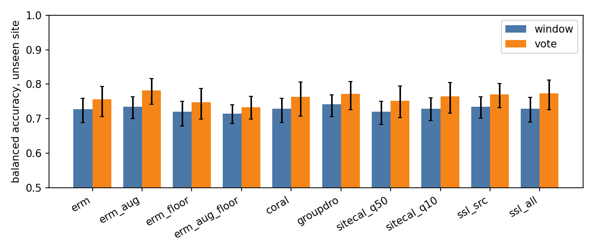

# sensewhere

**Does a radio-sensing classifier survive a new site, and what actually helps?**
A reproducible study on real public mmWave-radar and Wi-Fi sensing data: cross-site generalisation, source-free adaptation and adding classes after deployment. Every number below is generated by `scripts/analyze.py` from files in `results/`; the experiments ran on Kaggle.

## The problem

A radio network can sense moving people and objects (integrated sensing and communication). A model trained at one site is deployed at the next, usually without labels there, and new classes keep arriving. I ask three questions on the same data with one protocol:

1. How big is the cross-site gap, and does any training-time method close it?
2. Can a deployed model adapt using only unlabeled windows from the new site?
3. When a class is added, which design forgets least: flat softmax, hierarchical tree, mixture of experts, or nothing retrained at all (prototypes)?

**Data.** [DopplerWild](https://www.kaggle.com/datasets/dopplerwild/dopplerwild) (CC BY 4.0): TI IWR6843 mmWave radar micro-Doppler spectrograms of pedestrians at four sites, 410 labeled tracks of 302 subjects, three motion classes (walking, dual-hand load, on wheels) plus a held-out single-hand-load class, and 2,237 unlabeled tracks. Replication: [Widar 3.0](https://ieee-dataport.org/open-access/widar30-dataset-cross-domain-gesture-recognition-wi-fi) Wi-Fi velocity profiles (session 20181130: 9 users, 9 gestures, 5 torso locations).

## What I found

* **Sites are recognisable from the signal.** A gradient-boosting model tells the four sites apart with one-vs-rest AUC 0.720 (0.5 = cannot; site B 0.851), and per-window normalisation does not remove it. Sites are collection days, class mixes differ by site, and the background profile differs by site: at the same Doppler bin the typical level differs by about 4.6 dB on average (up to 7.7 dB) across the four sites (`kaggle/audit3`, 40 tracks per site).
* **Almost all errors are one confusion.** At an unseen site, walking is called dual-hand load 0.355 of the time and dual-hand load is called walking 0.322 of the time, while wheeled movement is recognised 0.912 of the time. The ceiling is how subtle a hand in a pocket is, not the site change.
* **Track pooling is the one effect that survived a confirmatory test.** The activity is constant within a track and a tracker supplies track ids, so averaging predictions over a track raises balanced accuracy. On fresh seeds 3 to 7, with the hypothesis written down before the run (`docs/CONFIRMATION.md`), the gain is 0.044 [0.029, 0.058] (balanced accuracy 0.785 [0.742, 0.815] against 0.741 [0.707, 0.767]).
* **Most clever training tricks did nothing measurable.** CORAL, augmentation, noise-floor transplant, site calibration and masked-reconstruction pretraining all stay within about one point of plain training at the window level (table below). This matches the DomainBed finding that a well-tuned plain model is hard to beat.
* **An apparent pipeline gain did not replicate.** On the exploratory seeds, noise-floor transplant + BatchNorm-only SHOT + track pooling looked 3.5 points better than plain training with track pooling. That pipeline was picked after looking at many combinations, so I tested it on fresh seeds: the difference is -0.003 [-0.028, 0.017], i.e. nothing beyond pooling. Augmentation with pooling, which looked best on the exploratory seeds, is -0.032 [-0.057, -0.001] against plain with pooling on the fresh seeds. Both early advantages were selection noise.
* **Adding a class without retraining works about as well as replay.** A prototype extension (one stored mean embedding per old class, the new class from a few labeled windows) reaches joint balanced accuracy 0.541 [0.525, 0.558] with 5 labeled windows and nothing trained, against 0.547 [0.531, 0.565] for head expansion with 5% replay. Fine-tuning the backbone without replay is catastrophic (old-class drop 0.405 [0.320, 0.494]).
* **The Wi-Fi replication differs.** On Widar, CORAL and DANN beat plain training by +0.014 [+0.006, +0.023], and BatchNorm adaptation helps about one point.
* **Viewing geometry fingerprints a site better than the radar image does, and it explains part of the errors.** Approach angle, speed and range alone identify site B with AUC 0.944. At site B walkers are slower than dual-hand carriers (-0.214 m/s; the other sites are +0.13 to +0.22), and walking recall there is 0.424. That is consistent with a speed shortcut, but four sites make it suggestive only (`docs/GEOMETRY.md`).
* **About thirty further ideas were tried after the confirmed result and none confirmed** (next section).

## Results



Training arms at an unseen site, with and without track pooling (mean over four sites, three seeds; intervals resample subjects):

| training arm | window balanced accuracy [95% CI] | diff vs plain [95% CI] | track-vote balanced accuracy [95% CI] | vote diff vs plain window [95% CI] |
|---|---|---|---|---|
| plain training | 0.728 [0.688, 0.759] | reference | 0.756 [0.707, 0.794] | 0.028 [0.008, 0.044] |
| + augmentation | 0.735 [0.701, 0.764] | 0.007 [-0.007, 0.025] | 0.782 [0.742, 0.817] | 0.054 [0.036, 0.077] |
| + noise-floor transplant | 0.720 [0.680, 0.750] | -0.008 [-0.023, 0.009] | 0.748 [0.700, 0.788] | 0.020 [-0.002, 0.043] |
| + augmentation + transplant | 0.715 [0.686, 0.740] | -0.013 [-0.033, 0.013] | 0.733 [0.699, 0.764] | 0.005 [-0.023, 0.038] |
| CORAL | 0.729 [0.689, 0.760] | 0.001 [-0.011, 0.013] | 0.764 [0.708, 0.807] | 0.036 [0.007, 0.059] |
| Group-DRO | 0.741 [0.706, 0.770] | 0.013 [0.001, 0.028] | 0.772 [0.726, 0.808] | 0.044 [0.022, 0.065] |
| site calibration (median profile) | 0.721 [0.684, 0.751] | -0.008 [-0.024, 0.012] | 0.752 [0.703, 0.795] | 0.024 [-0.001, 0.053] |
| site calibration (10th percentile) | 0.729 [0.694, 0.761] | 0.001 [-0.015, 0.022] | 0.764 [0.717, 0.805] | 0.036 [0.009, 0.065] |
| masked-reconstruction pretraining, source-site recordings only | 0.735 [0.702, 0.763] | 0.007 [-0.008, 0.026] | 0.771 [0.732, 0.802] | 0.043 [0.026, 0.062] |
| masked-reconstruction pretraining, all unlabeled recordings | 0.729 [0.690, 0.762] | 0.001 [-0.018, 0.021] | 0.774 [0.727, 0.812] | 0.046 [0.019, 0.071] |

Confirmatory test on fresh seeds 3 to 7. The hypotheses were fixed in `docs/CONFIRMATION.md` before this run, because the arm comparisons above are many and some differences look large by chance. Only H1 and H3 are confirmed, and H3 holds only because of track pooling (H2):

| hypothesis | A [95% CI] | B [95% CI] | A - B [95% CI] | A - B [Bonferroni 99.4% CI] | confirmed (95% interval entirely above zero) |
|---|---|---|---|---|---|
| H1 track pooling raises plain training | 0.785 [0.742, 0.815] | 0.741 [0.707, 0.767] | 0.044 [0.029, 0.058] | 0.044 [0.025, 0.062] | yes |
| H2 pipeline beats plain + track pooling | 0.782 [0.730, 0.818] | 0.785 [0.742, 0.815] | -0.003 [-0.028, 0.017] | -0.003 [-0.036, 0.023] | no |
| H3 pipeline beats plain, window readout | 0.782 [0.730, 0.818] | 0.741 [0.707, 0.767] | 0.040 [0.014, 0.061] | 0.040 [0.009, 0.067] | yes |
| H4 augmentation + pooling not worse than plain + pooling | 0.753 [0.714, 0.786] | 0.785 [0.742, 0.815] | -0.032 [-0.057, -0.001] | -0.032 [-0.064, 0.008] | no |

Class extension (single-hand load added to the 3-class model):

| method | backbone | replay | shots | old-class drop [95% CI] | new-class recall [95% CI] | joint balanced accuracy [95% CI] | trainable parameters |
|---|---|---|---|---|---|---|---|
| flat | finetune | 0.0 | - | 0.405 [0.320, 0.494] | 0.507 [0.298, 0.715] | 0.361 [0.328, 0.396] | 64820 |
| flat | finetune | 0.05 | - | 0.168 [0.132, 0.206] | 0.467 [0.384, 0.551] | 0.528 [0.513, 0.545] | 64820 |
| flat | finetune | 0.2 | - | 0.134 [0.102, 0.166] | 0.394 [0.308, 0.477] | 0.535 [0.515, 0.555] | 64820 |
| flat | frozen | 0.0 | - | 0.033 [0.018, 0.050] | 0.084 [0.043, 0.137] | 0.534 [0.518, 0.550] | 260 |
| flat | frozen | 0.05 | - | 0.058 [0.029, 0.091] | 0.214 [0.125, 0.306] | 0.547 [0.531, 0.565] | 260 |
| flat | frozen | 0.2 | - | 0.048 [0.024, 0.073] | 0.189 [0.111, 0.268] | 0.548 [0.531, 0.566] | 260 |
| hier | finetune | 0.0 | - | 0.593 [0.535, 0.645] | 0.866 [0.747, 0.960] | 0.321 [0.294, 0.348] | 64885 |
| hier | finetune | 0.05 | - | 0.160 [0.125, 0.196] | 0.381 [0.297, 0.470] | 0.524 [0.505, 0.540] | 64885 |
| hier | finetune | 0.2 | - | 0.126 [0.097, 0.155] | 0.342 [0.268, 0.424] | 0.540 [0.526, 0.556] | 64885 |
| hier | frozen | 0.0 | - | 0.235 [0.179, 0.281] | 0.525 [0.398, 0.636] | 0.504 [0.487, 0.524] | 325 |
| hier | frozen | 0.05 | - | 0.076 [0.054, 0.099] | 0.237 [0.158, 0.318] | 0.551 [0.535, 0.568] | 325 |
| hier | frozen | 0.2 | - | 0.076 [0.056, 0.096] | 0.236 [0.168, 0.299] | 0.551 [0.535, 0.568] | 325 |
| moe | finetune | 0.0 | - | 0.495 [0.405, 0.578] | 0.647 [0.458, 0.822] | 0.339 [0.306, 0.374] | 86985 |
| moe | finetune | 0.05 | - | 0.181 [0.159, 0.205] | 0.408 [0.344, 0.474] | 0.514 [0.496, 0.531] | 86985 |
| moe | finetune | 0.2 | - | 0.151 [0.115, 0.188] | 0.411 [0.323, 0.499] | 0.538 [0.523, 0.552] | 86985 |
| moe | frozen | 0.0 | - | 0.078 [0.048, 0.113] | 0.217 [0.127, 0.319] | 0.544 [0.528, 0.560] | 22425 |
| moe | frozen | 0.05 | - | 0.062 [0.036, 0.088] | 0.209 [0.140, 0.273] | 0.554 [0.541, 0.567] | 22425 |
| moe | frozen | 0.2 | - | 0.065 [0.039, 0.091] | 0.226 [0.161, 0.293] | 0.556 [0.543, 0.570] | 22425 |
| ncm | prototype | 0.0 | all | 0.101 [0.087, 0.114] | 0.306 [0.253, 0.352] | 0.548 [0.530, 0.565] | 0 |
| ncm | prototype | 0.0 | 5 | 0.098 [0.082, 0.114] | 0.272 [0.222, 0.319] | 0.541 [0.525, 0.558] | 0 |
| ncm | prototype | 0.0 | 20 | 0.102 [0.084, 0.120] | 0.287 [0.229, 0.341] | 0.542 [0.525, 0.559] | 0 |

### After the confirmed result: about thirty more ideas, none confirmed

I then tried to beat plain training with track pooling using ideas drawn from the radar physics and the dataset's structure (`docs/V3_PLAN.md`): torso-aligned inputs, Doppler-stretch augmentation, 3-second context, two tree topologies and mixture-of-experts heads with 2, 4 and 8 experts, multitask training on the 12 fine activities, ResNet-18 and MobileNetV2, attention and GRU track models, track-contrastive pretraining, seed and variant ensembles, and source-free recalibration of the walking vs dual-hand boundary. On the exploratory seeds none of the 23 single-factor arms beat the baseline (`docs/RESULTS.md`, section v3); several were clearly worse. The plan, selection rule and hypotheses were committed before the runs, and the candidates were then tested on fresh seeds 10 to 14.

Recalibration, ensembles and ensemble plus recalibration (family of five tests with the two below, so 99% Bonferroni intervals are in `docs/RECAL.md`):

| hypothesis | A [95% CI] | B [95% CI] | A - B [95% CI] | A - B [Bonferroni 98.3% CI] | confirmed (95% interval entirely above zero) |
|---|---|---|---|---|---|
| H7 median recalibration beats plain base (single models) | 0.788 [0.732, 0.830] | 0.782 [0.736, 0.817] | +0.006 [-0.013, +0.025] | +0.006 [-0.017, +0.029] | no |
| H8 5-seed ensemble beats the mean single model | 0.801 [0.741, 0.849] | 0.782 [0.736, 0.817] | +0.019 [-0.012, +0.046] | +0.019 [-0.017, +0.053] | no |
| H9 ensemble + median beats the mean single model | 0.802 [0.742, 0.847] | 0.782 [0.736, 0.817] | +0.019 [-0.016, +0.053] | +0.019 [-0.025, +0.056] | no |

Contrastive pretraining (H5) and the track-level GRU (H6):

| hypothesis | A [95% CI] | B [95% CI] | A - B [95% CI] | A - B [Bonferroni 99% CI] | confirmed (95% interval entirely above zero) |
|---|---|---|---|---|---|
| H5 source-only contrastive pretraining beats base | 0.774 [0.732, 0.809] | 0.782 [0.736, 0.817] | -0.009 [-0.033, +0.024] | -0.009 [-0.039, +0.033] | no |
| H6 track-level GRU beats base | 0.731 [0.691, 0.769] | 0.782 [0.736, 0.817] | -0.051 [-0.077, -0.022] | -0.051 [-0.084, -0.013] | no |

The recalibration looked like a +0.04 gain on the design seeds and measured +0.006 [-0.013, +0.025] on fresh seeds: a textbook winner's curse, which is why the confirmation step exists. About half of the foot tracks are classified right by some models and wrong by others while only about 5% are wrong for every model, so the remaining error is mostly variance near the walking vs dual-hand boundary and no variation I tried reduced it reliably.

Full tables, adaptation results and error analysis: [docs/RESULTS.md](docs/RESULTS.md).

## What did not work, stated plainly

* Track-consistency self-training (TCST), a source-free method I designed, is **not** better than plain BatchNorm adaptation: see the adaptation table in `docs/RESULTS.md`.
* Noise-floor transplant (swap a window's site background for another site's) and site calibration were physically motivated but gave no window-level gain on their own. Transplant followed by adaptation scored slightly higher than plain training followed by the same adaptation, but the intervals overlap, so I do not claim an effect.
* Masked-reconstruction pretraining on 24,457 unlabeled windows gave no significant window-level gain.
* The single-hand-load class stays hard: every method that keeps the old classes intact recognises it only a minority of the time. The higher new-class recalls in the extension table appear only where the model forgets the old classes (no-replay fine-tuning), so they are not a win.
* Flat, tree and mixture-of-experts heads are not distinguishable on the 12 fine activities: balanced accuracy 0.239 [0.198, 0.281] (flat), 0.240 [0.202, 0.274] (tree), 0.222 [0.189, 0.264] (mixture of experts).
* Track-level multiple-instance models (attention and GRU pooling over the windows of a track) are worse than simply averaging a window model's predictions: the GRU is -0.051 [-0.077, -0.022] against the baseline on the fresh seeds.
* Torso alignment (removing the walking speed) and Doppler-stretch augmentation, built to remove a suspected speed shortcut, lowered accuracy in the sweep; alignment raised dual-hand recall but lowered walking recall by more.
* Source-site validation is a weak guide to accuracy at a new site (correlation about 0.3 between the two), so single comparisons of close arms are not trustworthy; that is why intervals resample subjects and why the final claims come from a confirmatory run whose hypotheses were fixed in advance.

## v1 to v2

v1 results are kept as a baseline in `docs/RESULTS.md` (sections without "v2"). After seeing them I audited the code ([docs/AUDIT.md](docs/AUDIT.md)) and found real defects: augmentation was silently on for every method except plain training; a "frozen" backbone still updated its BatchNorm statistics; and a time-index mistake had put 30% of windows outside their tracks (caught by a quality-control check, fixed, and the build now aborts if it happens). v2 fixes these, selects each method's strength setting by nested leave-one-source-site-out (the early-stopping epoch is still chosen on source-site validation windows, which stays a weak guide), and adds noise-floor transplant, site calibration, masked-reconstruction pretraining, track voting, track-consistency self-training and prototype extension. Most of those additions did not help; that is reported above.

## Reproduce

```
pip install -e .[dev]
pytest                                   # unit and regression tests on synthetic fixtures; no result comes from synthetic data
python scripts/analyze.py                # tables, figures and docs/RESULTS.md from results/
python scripts/make_readme.py            # regenerates this file from README.template.md and results/tables
```

The experiments run as Kaggle script kernels (`kaggle/*`): `build` and `build2` create the cached windows, `stage*` run the experiments; `scripts/push_src.sh` publishes the package as a private Kaggle dataset. The design is in [docs/BLUEPRINT.md](docs/BLUEPRINT.md), the literature in [docs/LITERATURE.md](docs/LITERATURE.md).

## Limitations

Only the track-pooling effect was confirmed on fresh seeds; the extension, adaptation and Widar results are exploratory single runs with the intervals shown. Small data (302 subjects, 17 windows per subject), four sites that are also four collection days, 3 seeds per cell, one backbone family (a small CNN), and a coarse three-class task. Intervals for numbers without saved predictions resample site-by-seed cells, which is coarse. Widar intervals resample cells, not users. Nothing here says anything about newer or larger models.

## License and data

Code: MIT. DopplerWild is CC BY 4.0; Widar 3.0 is subject to its own terms. Neither dataset is redistributed here.
