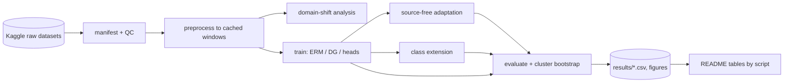

# sensewhere: technical blueprint

Scaled to a research repository. Collapsed sections (reason in brackets): actors and roles, API design, event architecture, frontend, background jobs, authn/authz, state machines [no service, no users, a batch experiment pipeline]; kept: requirements, architecture, data, algorithms, ML design, validation protocol, testing, configuration, repository layout, build order, risks, ADRs, definition of done.

## 1. Executive summary

**Question.** Radio networks can sense moving objects (integrated sensing and communication, ISAC). A classifier trained at one site often fails at the next, and new object classes keep arriving. sensewhere measures, on real public data and with one protocol, (a) how large the cross-site gap is, (b) which training-time method (domain generalisation) and which deployment-time method that sees only unlabeled target data (source-free adaptation) closes it, and (c) which head design (flat softmax, hierarchical tree, mixture of experts) loses least when classes are added.

**Data.**
- *DopplerWild* (Kaggle `dopplerwild/dopplerwild`): mmWave radar (TI IWR6843) micro-Doppler spectrograms of pedestrians at four sites; 844 labelled tracks, 539 subjects, 12 atomic activities that roll up deterministically into 3 motion classes, 90 time bins per second, 256 Doppler bins; a `location` column supports leave-one-location-out. Primary study.
- *Widar 3.0 BVP* (Kaggle `mohoremukhopadhyay/widar-3-0-bvp`): Wi-Fi body-coordinate velocity profiles, 43,658 files, gestures recorded for several users, torso locations and facing orientations. Replication arm for the generalisation and adaptation questions (no hierarchy is given, so no tree arm).

**Outputs.** A manifest-driven preprocessing pipeline with quality control; a domain-shift analysis; a benchmark table with subject-clustered bootstrap intervals; a class-extension experiment; a README whose every number is generated by script.

**Key challenges.** Label shift confounds covariate shift across sites; subjects must never cross splits; model selection without target labels; entropy-based adaptation can collapse; extension results depend on the replay budget so it is fixed and reported.

## 2. Requirements

| Id | Requirement | Priority |
|---|---|---|
| F1 | Build window manifests from the raw datasets; every row traceable to a source file | must |
| F2 | Preprocess to fixed-size tensors with a logged QC report (rows dropped, why) | must |
| F3 | Quantify domain shift before modelling (class priors, spectral fingerprints, can a classifier tell sites apart) | must |
| F4 | Leave-one-location-out protocol, subject-disjoint, validation drawn from source sites only | must |
| F5 | Baselines: majority class, gradient boosting on hand-built features, CNN trained with ERM | must |
| F6 | DG methods: ERM+augmentation, CORAL, DANN, Group-DRO | must |
| F7 | Source-free methods: AdaBN, Tent, SHOT-IM; only source model + unlabeled target windows as input | must |
| F8 | Heads: flat, hierarchical, mixture of experts, identical backbone | must |
| F9 | Class-extension experiment with fixed replay budgets | must |
| F10 | Widar replication of F4 to F7 | should |
| F11 | Everything configurable by YAML; results reproducible from config + seed | must |
| N1 | Runs on Kaggle (CPU for preprocessing, one GPU for training); nothing large downloaded to the author's laptop | must |
| N2 | No result in the README that a script did not produce | must |
| N3 | Unit tests on every statistical or data-handling step | must |

## 3. Architecture



Execution model: a Kaggle script kernel per stage; the preprocessed windows are a private Kaggle dataset produced by the preprocessing kernel and consumed by training kernels via `dataset_sources`. Choice and alternatives in ADR-1.

## 4. Component design

| Component | Responsibility | Must not |
|---|---|---|
| `manifest` | parse raw file tree and CSVs into one row per window with subject, site, label, source path | read signal values beyond what QC needs |
| `preprocess` | window slicing, transform, crop, normalise, QC flags | use target-site statistics when processing source data |
| `splits` | LOLO with source-only validation, subject disjointness assertion | touch target labels for selection |
| `features` | hand-built descriptors for the gradient-boosting baseline | share fitted state across splits |
| `models` | backbone and three heads, `extend()` for new classes | hold dataset-specific constants |
| `dg` | CORAL, DANN, Group-DRO | select hyperparameters by target accuracy |
| `adapt` | AdaBN, Tent, SHOT-IM returning adapted copy + entropy trace | mutate the source model |
| `metrics` | balanced accuracy, macro-F1, subject-cluster bootstrap, paired difference | resample windows (subjects are the unit) |
| `train` | one loop for all methods, seeds, checkpoints by source validation | contain method logic |
| `report` | tables and figures from result CSVs | contain numbers |

## 5. Data architecture

Window manifest (one row per 1 s window; DopplerWild):

| Field | Type | Notes |
|---|---|---|
| `window_id` | str | `{file_name}_{global_id}_{t_start}` unique |
| `subject` | str | `global_id`; never crosses splits |
| `location` | str | site; the domain |
| `label_atomic`, `label_load` | str | fine and rolled-up class; rolled-up is a function of fine |
| `fold_cs` | int | the dataset's own cross-subject fold, kept for comparison |
| `track_path`, `t_start`, `t_end` | str, float | pointer into the raw track |
| `occlusion_s`, `neighbours_5m` | float | scene context, used for stratified error analysis only |
| `qc_flag` | str | `ok` or the reason the window was dropped |

Widar manifest: `path, date, user, gesture, torso_loc, face_ori, rep, group, qc_flag`; the filename encodes user, gesture, torso location, orientation and repetition; the folder date is the recording session.

Cached tensors: `float16` array `(N, 1, F, T)` plus `meta.parquet` aligned by row; checksum stored beside it. Versioned by a hash of the preprocessing config.

## 6. Preprocessing design (decisions follow the data audit in `docs/DATA_AUDIT.md`)

1. Slice exactly the window the CSV names (90 bins at 90 bins/s); reject windows shorter than expected.
2. Value transform: decided from the audit (linear vs dB); log-compress if the dynamic range spans orders of magnitude.
3. Static clutter: suppress the zero-Doppler neighbourhood by a configurable number of bins; the audit shows how much energy sits there.
4. Crop Doppler to the occupied band, then area-downsample to the configured height.
5. Per-window standardisation (not per-site): per-site statistics would hide the very shift under study. A per-site variant is an ablation.
6. QC: drop NaN/inf, near-constant windows, windows with occlusion above a configured threshold; every drop is counted per site and class in `qc_report.csv`.
7. No augmentation at cache time; augmentation lives in the training loop and is configurable.

## 7. Algorithms and core logic

- **Domain shift analysis.** (i) class prior per site; (ii) mean spectral envelope per site; (iii) a site classifier on the preprocessed windows by subject-grouped cross-validation: AUC well above 0.5 shows that site is recoverable from the signal; (iv) the same with hand-built features. Output: table and figure; used to interpret the later gaps.
- **Protocol.** For each target site: train on the other sites, select epoch and hyperparameters by balanced accuracy on source validation subjects, then evaluate once on the target. An oracle row (selection on target labels) is reported separately and labelled as an upper bound, never as a method.
- **DG.** ERM; ERM with time-shift, amplitude and Doppler-bin jitter augmentation; CORAL on backbone features; DANN with the source site as domain label; Group-DRO over source sites.
- **Source-free adaptation.** Applied to the ERM model of each split using unlabeled target windows only: AdaBN (statistics), Tent (BN affine, entropy), SHOT-IM (backbone, information maximisation, frozen head). Entropy and predicted-class histogram are logged per step; a run is flagged collapsed if one class takes more than a configured share of predictions.
- **Class extension.** Base: the three motion classes. New class: single-hand load (its own labelled subjects). For each head: copy the trained base, `extend()`, fine-tune on new-class data plus a replay buffer of old-class windows at budget r in a configured list (0, 5%, 20% of old training data). Report old-class balanced accuracy before and after, new-class recall, drop, and parameters touched. The hierarchical head grows only the local node; the MoE adds an expert and freezes old experts (ablation: not frozen).
- **Hierarchical arm.** The tree follows the dataset's own hierarchy (root → walking / load / wheels; load → its atomic activities for the fine-label variant). No tree is invented from data.
- **Statistics.** Subject-clustered percentile bootstrap, 1000 resamples; paired differences against ERM on identical windows; multiple comparisons: report all methods, no cherry-picking, and state the number of comparisons.

## 8. ML design

Backbone: four conv blocks with BatchNorm (needed for AdaBN and Tent), global pooling, 64-dimensional feature. Chosen small because SenseFi reports CNN/GRU backbones are strong for radio sensing and because the cross-site gap, not capacity, is the object of study. Losses: cross-entropy with class-balanced weights (class priors are skewed), plus method terms. Seeds: three per cell. Training budget per run configured in YAML. Checkpoint selection by source validation only. Versioning: config hash and git commit written into every result row.

## 9. Testing strategy

- Unit: metrics, bootstrap coverage, splits (disjointness, no target leakage, rejects a subject at two sites), heads (normalised log-probabilities, extension keeps old logits, hierarchical extension touches only the parent), DG losses, adaptation (does not mutate the source model, BN-only updates for Tent, frozen head for SHOT-IM).
- Data: manifest row counts equal CSV row counts; windows have the configured shape; QC counts add up; label roll-up is a function of the fine label.
- Property: any extension leaves `exp(logp)` summing to one.
- Integration: a tiny synthetic dataset runs the whole pipeline end to end locally (synthetic data used only as a test fixture, never in results).
- Reproducibility: same config and seed give identical results on CPU for the baseline.

## 10. Configuration

One YAML per experiment (`configs/*.yaml`), validated by pydantic: dataset roots (env var `SENSEWHERE_DATA`), preprocessing parameters, split seed, methods, hyperparameter grids, replay budgets, bootstrap size, output directory. Secrets: none (Kaggle credentials stay in the user's own CLI config).

## 11. Repository layout

```
sensewhere/
  README.md  pyproject.toml  LICENSE
  configs/            experiment YAMLs
  docs/               LITERATURE.md  BLUEPRINT.md  DATA_AUDIT.md
  kaggle/             one folder per kernel (metadata + script)
  src/sensewhere/     manifest, preprocess, features, splits, models, dg, adapt, metrics, train, report
  tests/
  results/            CSV and figures produced by scripts (committed, small)
```

## 12. Build order

1. Data audit kernel (done for structure; extended audit on preprocessing choices). 2. Manifest + QC + preprocess + cached dataset. 3. Domain-shift analysis. 4. Baselines (majority, gradient boosting, ERM CNN). 5. DG methods. 6. Source-free methods. 7. Class extension. 8. Widar replication. 9. Report generation and README.

## 13. Failure and recovery

| Failure | Detection | Response |
|---|---|---|
| Kaggle kernel dies or times out | kernel status | stages write per-split result files; rerun skips finished cells |
| NaN in loss | finite check each step | abort the cell, record it as failed in the result table (not silently dropped) |
| Adaptation collapse | entropy trace and class histogram | report collapsed runs as such |
| Class missing at a held-out site | per-class support check | metric skips absent classes; support is reported |
| Corrupt or empty raw file (known for Widar CSI archives) | QC | flag and count in `qc_report.csv` |

## 14. Risks

| Risk | Consequence | Mitigation |
|---|---|---|
| Sites differ in class mix | gap is label shift, not signal shift | balanced metrics, per-site priors reported, prior-matched ablation |
| Tuning budget unequal across methods | unfair ranking (DomainBed lesson) | same grid size and seed count for every method |
| Few subjects per site | wide intervals | subject-clustered bootstrap, report widths, no claims beyond them |
| Negative results | nothing "wins" | that is a result; reported as numbers |
| Compute quota | incomplete grid | stage-wise checkpoints; shrink grid by config, document it |

## 15. ADRs

- **ADR-1 Kaggle kernels over local runs.** Alternatives: local laptop (rejected: user asked for no local downloads), Modal (credits used up). Consequence: file-based hand-off between stages.
- **ADR-2 CNN with BatchNorm backbone.** Alternatives: Transformer, GRU. BatchNorm is required by AdaBN/Tent; SenseFi supports small CNN/GRU strength.
- **ADR-3 Subject is the resampling unit.** Windows overlap (0.25 s stride) and share a person.
- **ADR-4 No target labels for selection.** Following AdaTime and DomainBed; oracle reported separately as an upper bound.
- **ADR-5 Hierarchy taken from the dataset.** No data-derived tree, so the tree arm tests a design, not a clustering artefact.
- **ADR-6 Widar as replication only.** No given hierarchy; restricted to generalisation and adaptation.

## 16. Definition of done

Raw to cached windows by script with a QC report; domain-shift table produced; every method in F5 to F9 run for all four DopplerWild sites and three seeds; Widar replication run or its absence stated; all unit tests pass; README tables regenerated by `report` from `results/`; no number typed by hand; repo reproducible from configs on Kaggle.

## 17. REQUIRES USER DECISION

1. Publish the repo publicly under her GitHub (`sriyaaa2003/sensewhere`, MIT) once results exist? (Her other repos are public and MIT.)
2. Whether the resume lists the project before the results are final (recommended: no).
